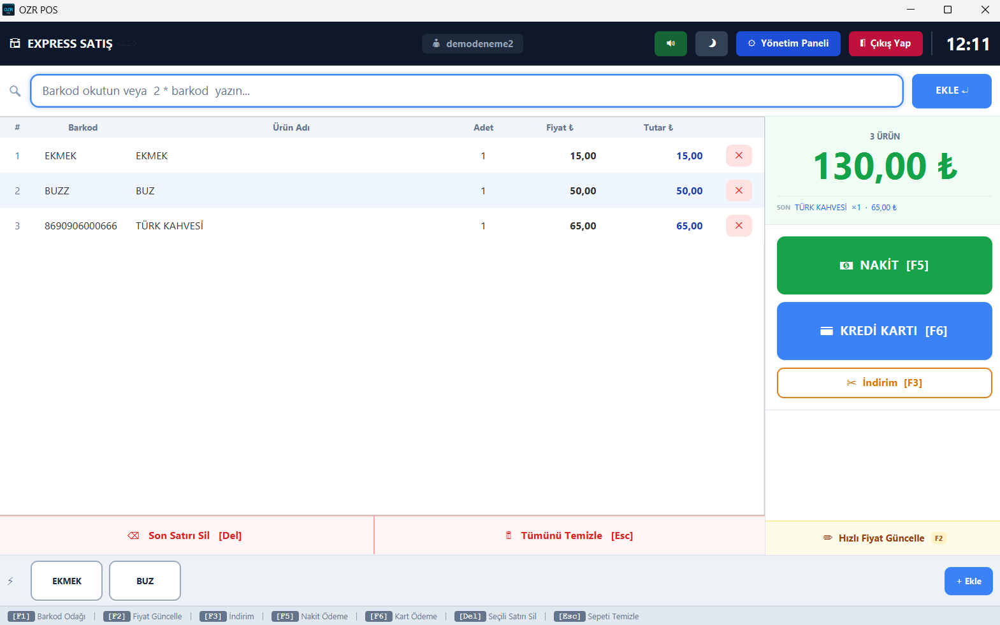
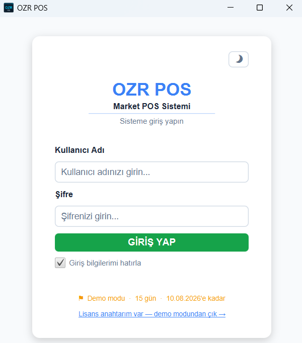
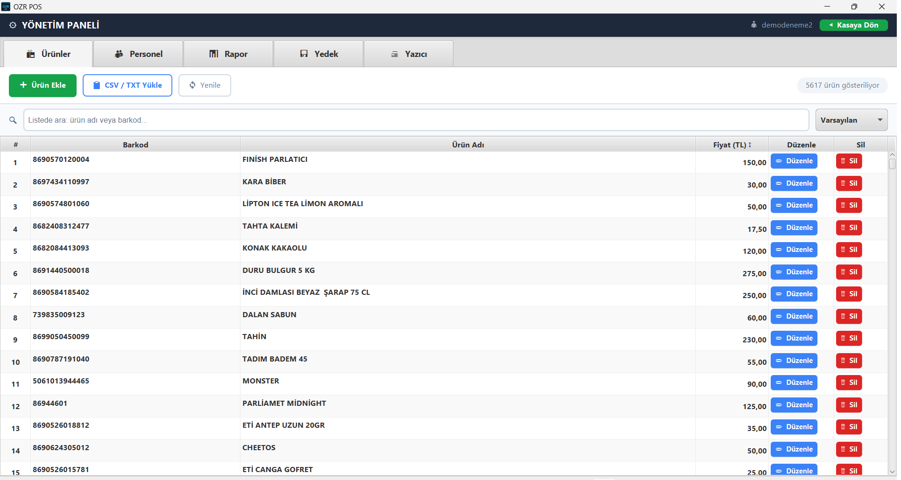
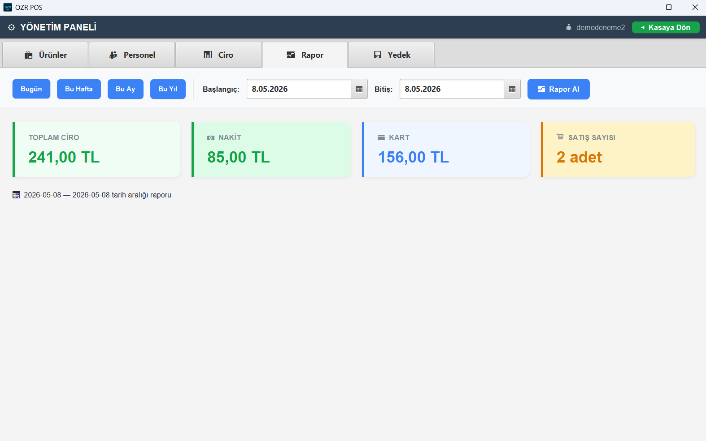
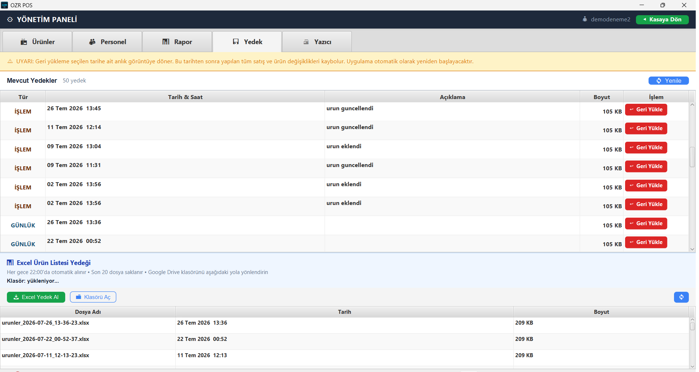
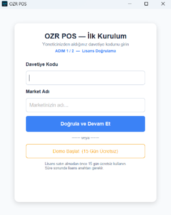
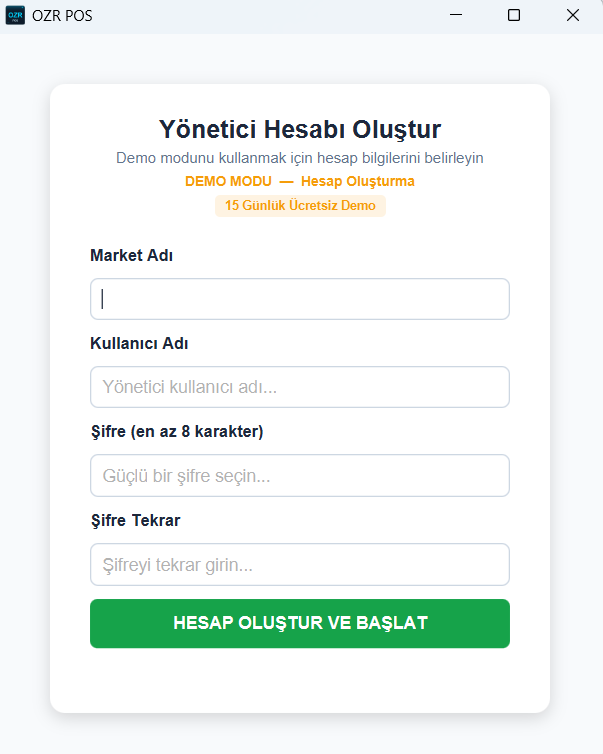
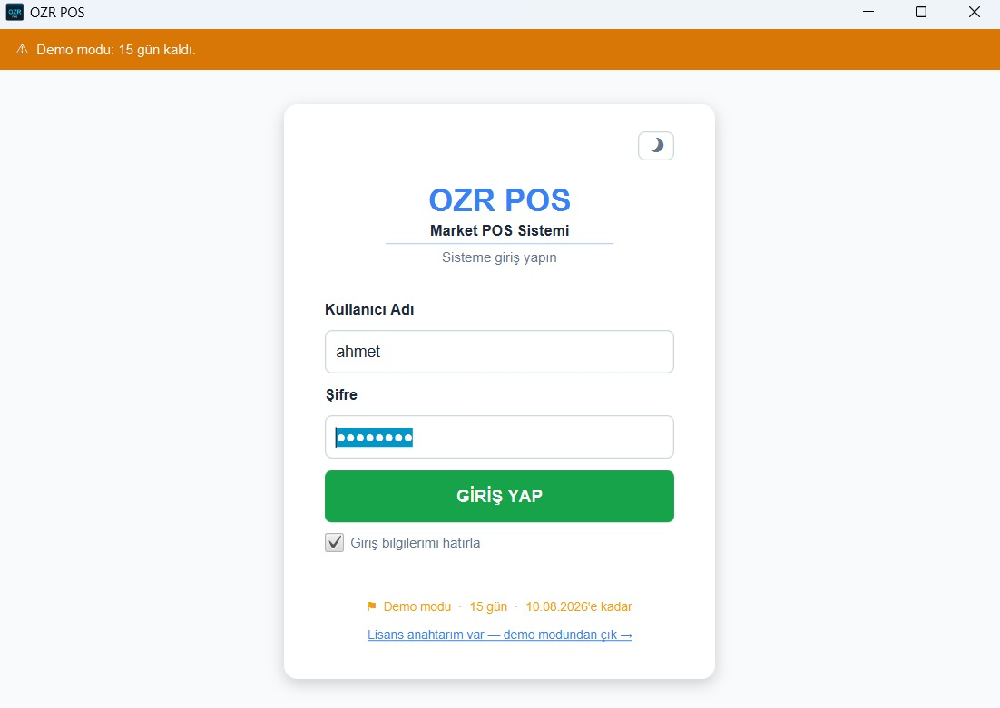
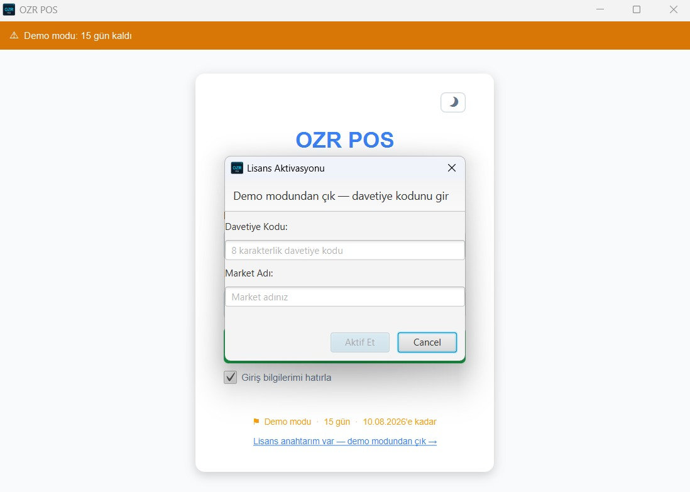

# OZR POS

**Profesyonel Market Kasa Sistemi · Professional Point of Sale System**

[**🌐 Web Sitemiz / Website**](https://emirhanozer07.github.io/ozrpos-site/) &nbsp;·&nbsp; [**⬇ İndir / Download**](#-kurulum--installation) &nbsp;·&nbsp; [**🔑 Lisans Al / Get License**](#-lisans-ve-iletişim--license--contact) &nbsp;·&nbsp; [**💾 Yedek Rehberi / Backup Guide**](YEDEK_REHBERI.md) &nbsp;·&nbsp; [**📋 Değişiklikler / Changelog**](CHANGELOG.md)

---

> **TR** — Bakkal, tekel ve küçük marketler için geliştirilmiş, güvenli, internet bağlantısı gerektirmeyen masaüstü kasa yazılımı. Tüm verileriniz şifrelenerek yalnızca kendi bilgisayarınızda saklanır.

> **EN** — A secure, offline-first desktop Point of Sale system for grocery, kiosk and small retail stores. No internet required for daily operations. Your data never leaves your computer.

---

## 📸 Ekran Görüntüleri / Screenshots

### Kasa / Satış Ekranı

Diğer ekranlar / More screenshots

### Giriş Ekranı

### Ürün Yönetimi

### Satış Raporları

### Yedekleme

### İlk Kurulum / 15 Gün Ücretsiz Demo

---

## ✨ Özellikler / Features

| | TR | EN |
|---|---|---|
| 🛒 Kasa | Barkod okuyucu, **çoklu sepet (3 kasa — aynı anda 3 müşteri)**, nakit/kart ödeme, isimle ürün arama, fiyat sorma, klavye kısayolları | Barcode scanner, **multiple parked carts (3 registers)**, cash/card payment, search by name, price check, keyboard shortcuts |
| 📒 Veresiye | Müşteri borç defteri: kasadan veresiye satış ve tahsilat, borç limiti, fiş/makbuz, otomatik Excel defter yedeği | Customer credit ledger: credit sales and payments at checkout, credit limits, receipts, automatic Excel ledger backup |
| 📦 Ürünler | Tekil ekleme veya Excel/CSV listesinden toplu yükleme (dosya başına 10.000 ürüne kadar; Türkçe karakterler ve farklı fiyat yazımları otomatik tanınır) | Single add or bulk Excel/CSV import (up to 10,000 products per file; Turkish characters and price formats recognised automatically) |
| 👥 Personel | ADMIN ve KASİYER rolleri, şifre değiştirme | ADMIN and CASHIER roles, password management |
| 📊 Raporlar | Günlük/dönemsel ciro, nakit-kart-veresiye ayrımı | Daily/periodic revenue, cash/card/credit breakdown |
| 💾 Yedekleme | Günlük + her işlemden sonra şifreli otomatik yedek, günlük Excel ürün listesi | Encrypted automatic daily and per-operation backups, daily Excel product list |
| ♻️ Geri Yükleme | Günlük ve işlem yedeklerinden geri dönüş; öncesinde mevcut veri ayrıca yedeklenir | Restore from daily and per-operation backups; current data is backed up first |
| 🔄 Güncelleme | Yeni sürüm bildirimi gelir, tek onayla indirilip uygulanır | Update notification appears; one click downloads and applies it |
| 🌙 Tema | Karanlık / Aydınlık tema | Dark / Light theme |
| 🔒 Güvenlik | Şifreli veritabanı ve yedekler, rol bazlı yetki, giriş denemesi sınırı | Encrypted database and backups, role-based access, login attempt limit |

---

## 🎯 15 Günlük Ücretsiz Demo / 15-Day Free Trial

**TR:** İlk açılışta **"Demo Başlat"** butonuna tıklayın. 15 gün boyunca tüm özellikler tam olarak çalışır. Demo süresi dolduğunda lisans anahtarı ile aynı kurulumdan devam edin — verileriniz korunur.

**EN:** Click **"Start Demo"** on first launch. All features work fully for 15 days. After the trial, enter your license key to continue from where you left off — your data is preserved.

Demo süreci ekranları / Demo flow screenshots

### Kalan süre bildirimi / Days-remaining banner

### Lisans aktivasyonu / License activation

---

## 🚀 Kurulum / Installation

**Gereksinimler / Requirements:** Windows 10/11 (64-bit) — Java kurulumu gerekmez / No Java required

### TR — Kurulum Adımları

1. [**Releases**](https://github.com/EmirhanOzer07/OZR-Pos/releases/latest) sayfasından `OZRPos-vX.Y.Z.zip` indirin
2. ZIP'e sağ tıklayın → **Tümünü Çıkar** → `C:\OZRPos` klasörüne taşıyın
3. `OZRPos.exe`'ye sağ tıklayın → **Gönder → Masaüstü (kısayol oluştur)**
4. Uygulamayı açın → **Demo** ile başlayın veya davetiye kodunuzu girin
5. Market adı, kullanıcı adı ve şifrenizi belirleyin — kurulum tamamdır

### EN — Installation Steps

1. Download `OZRPos-vX.Y.Z.zip` from the [**Releases**](https://github.com/EmirhanOzer07/OZR-Pos/releases/latest) page
2. Right-click ZIP → **Extract All** → move to `C:\OZRPos`
3. Right-click `OZRPos.exe` → **Send to → Desktop (create shortcut)**
4. Launch → start with **Demo** or enter your invitation code
5. Set store name, username, and password — done

> **⚠️ TR:** ZIP'i `C:\Program Files\` içine **KURMAYIN** — otomatik güncellemeyi engeller. `C:\OZRPos\` veya masaüstü kullanın.

> **⚠️ EN:** Do **NOT** install under `C:\Program Files\` — it blocks auto-updates. Use `C:\OZRPos\` or Desktop.

> **Windows SmartScreen:** "Ek bilgi" → "Yine de çalıştır" / "More info" → "Run anyway"

---

## 🔑 Lisans ve İletişim / License & Contact

### TR — Nasıl Lisans Alınır?

1. Uygulamayı kurun ve açın — ilk açılışta **"Demo Başlat"** ile 15 günlük ücretsiz demoyu başlatın
2. Lisans almak için WhatsApp'tan ya da e-postayla bize ulaşın
3. Tarafınıza 8 karakterlik **davetiye kodu** iletilir
4. Kodu uygulamanın kayıt ekranına girin → marketiniz aktive edilir

> Lisanslar market başına satılmaktadır. Demo süresi boyunca tüm özellikler tam çalışır.

### EN — How to Get a License

1. Install and open the application — click **"Start Demo"** on first launch for the 15-day free trial
2. Contact us via WhatsApp or email to purchase a license
3. You will receive an 8-character **invitation code**
4. Enter the code on the app's registration screen → your store is activated

> Licenses are sold per store. All features work fully during the demo period.

| | |
|---|---|
| **WhatsApp / Telefon** | [**+90 546 278 23 00**](https://wa.me/905462782300) |
| **Email / E-posta** | **emirhann0077@gmail.com** |
| **Yanıt Süresi / Response** | 24 saat içinde / Within 24 hours |

---

## ❓ Sık Sorulan Sorular / FAQ

<strong>İnternet bağlantısı şart mı? / Is internet required?</strong>

**TR:** Hayır. Günlük satış işlemleri için internet gerekmez. Yalnızca güncelleme, lisans doğrulaması ve teknik sağlık raporu için kullanılır.

**EN:** No. Daily operations work offline. Internet is only used for updates, license validation and the technical health report.

<strong>Verilerim nerede saklanıyor? / Where is my data stored?</strong>

**TR:** Tüm veriler şifrelenmiş olarak kendi bilgisayarınızda saklanır (veritabanı AES, yedekler AES-256). Satış, ürün, müşteri ve veresiye verileriniz bilgisayarınızdan çıkmaz. İnternet yalnızca lisans doğrulaması, güncelleme kontrolü ve destek amaçlı teknik sağlık raporu (sürüm, işletim sistemi, son yedek zamanı, hata özetleri gibi teknik bilgiler — işletme verisi içermez) için kullanılır. Ayrıntılar: [Gizlilik](https://emirhanozer07.github.io/ozrpos-site/gizlilik.html)

**EN:** All data is stored locally on your computer, encrypted (AES database, AES-256 backups). Your sales, product, customer and credit-ledger data never leave your computer. The internet is used only for license validation, update checks and a technical health report for support (version, OS, last backup time, error summaries and similar technical information — no business data). Details: [Privacy](https://emirhanozer07.github.io/ozrpos-site/gizlilik.html)

<strong>Birden fazla kasa kullanılabilir mi? / Multiple registers?</strong>

**TR:** OZR POS bir market için tek bilgisayarda çalışır. Aynı kasada **3 ayrı sepet** açıp aynı anda 3 müşteriye hizmet verebilirsiniz; ancak birden fazla bilgisayarı ağ üzerinden birbirine bağlamaz.

**EN:** OZR POS runs on a single computer per store. You can keep **3 separate carts** open at the same register to serve 3 customers at once, but it does not network multiple computers together.

<strong>Kaç ürün eklenebilir? / How many products?</strong>

**TR:** Pratik bir ürün sınırı yoktur. Excel/CSV ile toplu yüklemede dosya başına 10.000 ürüne kadar yüklenir; daha büyük listeler birkaç dosyaya bölünerek yüklenebilir.

**EN:** There is no practical product limit. Bulk Excel/CSV import accepts up to 10,000 products per file; larger lists can be split into several files.

<strong>Bilgisayar bozulursa verilerimi kurtarabilir miyim? / What if my computer breaks?</strong>

**TR:** Evet — yedek aldıysanız. Detaylı kurtarma rehberi için: [**💾 Yedek ve Kurtarma Rehberi**](YEDEK_REHBERI.md)

Özet: Uygulama her gün ve her önemli işlemden sonra otomatik yedek alır. Bu yedekleri Google Drive ile senkronize etmenizi öneririz. Bilgisayar değişirse lisans aktarımı için bizimle iletişime geçin — ücretsizdir.

**EN:** Yes — if you have backups. See the full guide: [**💾 Backup & Recovery Guide**](YEDEK_REHBERI.md)

Summary: The app takes automatic backups every day and after every important operation. We recommend syncing them to Google Drive. If you change computers, contact us for a free license transfer.

<strong>Otomatik güncelleme nasıl çalışır? / How do auto-updates work?</strong>

**TR:** Uygulama her açılışta arka planda yeni sürüm olup olmadığını kontrol eder. Yeni sürüm varsa bildirim gelir, onayladıktan sonra güncelleme indirilir ve uygulanır. Verileriniz korunur.

**EN:** The app silently checks for updates on each launch. When a new version is available, you'll be notified. After confirmation, the update is downloaded and applied. Your data is preserved.

---

## 🔐 Veri Güvenliği / Data Security

| Katman / Layer | Uygulama / Implementation |
|---|---|
| Veritabanı / Database | Şifreli, kuruluma özel anahtar / Encrypted, per-install key |
| Yedekler / Backups | AES-256 şifreli yedek dosyaları / AES-256 encrypted backup files |
| Şifreler / Passwords | Geri çözülemez biçimde saklanır / Stored in a non-reversible form |
| Giriş / Login | Hatalı giriş denemeleri sınırlandırılır / Failed login attempts are rate-limited |
| Yetkilendirme / Authorization | Yönetici ve kasiyer rolleri / Administrator and cashier roles |

> **TR:** Tüm şifreleme anahtarları kurulum sırasında üretilir ve yalnızca sizin makinenizde saklanır. OZR POS, işletme verilerinizi (satış, ürün, müşteri, veresiye) hiçbir sunucuya iletmez.

> **EN:** All encryption keys are generated at install time and stored only on your machine. OZR POS never transmits your business data (sales, products, customers, credit ledger) to any server.

---

## 📋 Sürüm Geçmişi / Changelog

Tüm sürüm notları için: [**CHANGELOG.md**](CHANGELOG.md)

**Son sürüm / Latest:** v2.3.10 — Daha akıllı CSV ürün yükleme ve daha güvenli yedek geri yükleme / Smarter CSV product import and safer backup restore

---

## 📄 Lisans / License

Copyright © 2026 Mustafa Emirhan Özer. Tüm hakları saklıdır / All rights reserved.

Bu yazılım tescilli mülkiyettir. İzinsiz kopyalama, dağıtım veya tersine mühendislik yasaktır.
This software is proprietary. Unauthorized copying, distribution, or reverse engineering is prohibited.

Tam koşullar için / For full terms: [LICENSE.md](LICENSE.md)

---

Windows 10/11 · [Web sitesi / Website](https://emirhanozer07.github.io/ozrpos-site/)

**© 2026 Mustafa Emirhan Özer**

